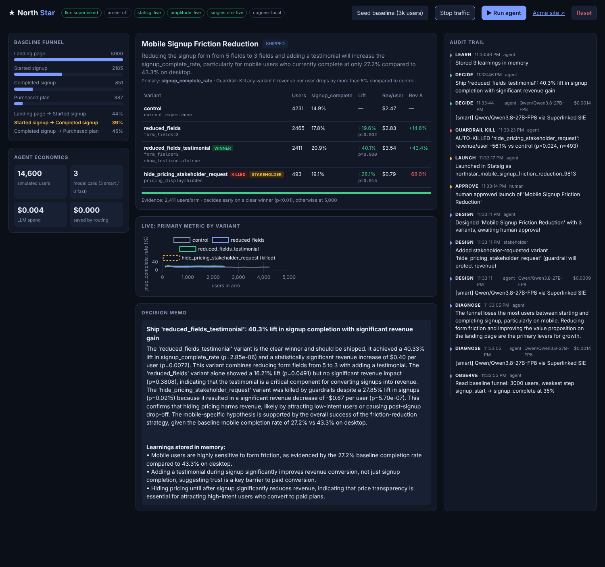
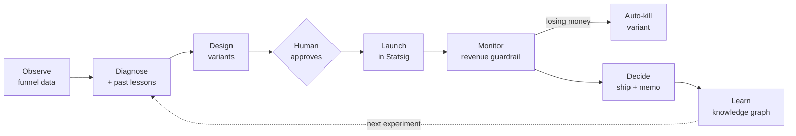
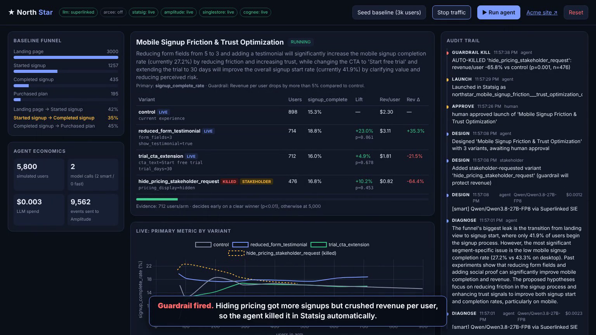
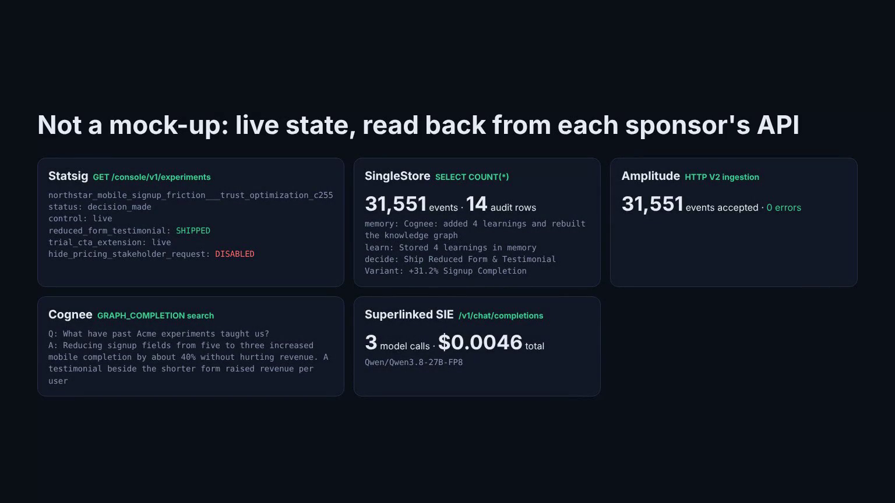

# ★ North Star

**An autonomous growth PM that runs your A/B tests end to end, and protects revenue while it does.**

North Star finds where users drop off in your funnel, designs experiments to fix it, launches them in
Statsig after a human approves, **kills any variant that starts losing money**, ships the winner, and
remembers what it learned for next time. Every decision comes with the data, the model output and the
cost behind it.

**[▶ Watch the 2:40 demo](demo/northstar-demo.mp4)** (a narrated recording of a live, unedited run)



---

## The problem

A growth team ships maybe one experiment a week. Most of that time goes to the busywork around the
idea: pulling funnel numbers, writing the test plan, configuring the flag, checking the dashboard
every morning, and writing up the result. Meanwhile a bad variant can quietly bleed revenue for days
before anyone looks.

## What North Star does

It runs the whole experimentation loop as an agent:



**The model makes the judgment calls; code enforces the safety.** The model diagnoses the funnel,
proposes hypotheses, designs the experiment and writes the decision memo. Hard rules (significance
tests, minimum sample sizes, the revenue guardrail) live in code, so the agent can't talk itself into
shipping a loser.

## What happened in the demo run

We pointed North Star at **Acme Cloud**, a simulated SaaS signup funnel with 3,000 visitors.

1. **It found the leak.** Only 35% of people who started signing up finished. Splitting by device, the
   agent spotted the real problem: **mobile completion was 27.2% vs 43.3% on desktop.** Its knowledge
   graph also recalled that shorter forms had worked before.
2. **It designed an experiment** with two variants: a 3-field form with a customer testimonial, and a
   new call to action with a longer trial. Variants are just parameters, so nothing needs a deploy.
3. **A stakeholder asked to test hiding pricing until after signup.** North Star added it as a variant,
   clearly labeled as a stakeholder request.
4. **A human approved the launch**, and North Star created and started the experiment in Statsig.
5. **The guardrail fired.** Hiding pricing *did* get more signups (+10%), but revenue per user fell
   **65.8%** (p = 0.001). North Star disabled that variant in Statsig automatically, mid-experiment.

   

6. **It shipped the winner.** The 3-field form with a testimonial lifted completed signups by
   **+31.2% (p = 0.0007)** and raised revenue per user. North Star made the ship decision in Statsig and
   wrote a memo explaining why, with the numbers.
7. **It learned.** The lessons went into a Cognee knowledge graph, and the next diagnosis cites them.

**The model calls for that whole experiment cost $0.0046.**

## Built on our partners' platforms

Every integration is live and verified against the real APIs, not mocked. At the end of the demo,
North Star reads its state back from each one:



| Partner | What it does in North Star |
|---|---|
| **Superlinked SIE Serverless** | All of the agent's reasoning: diagnosis, experiment design, monitoring notes and decision memos, on Qwen3.8 27B with strict JSON-schema output, so every answer is machine-checkable. About half a cent per experiment. |
| **Statsig** | The agent's hands. Through the Console API it creates and starts experiments, disables a losing variant mid-test, and makes the ship decision on the winning group. |
| **Amplitude** | Every product event (landing, signup start, signup complete, purchase) streams in live, with experiment and variant attached. 31,551 events in the demo run, zero errors. |
| **SingleStore** | The system of record: the event stream North Star runs its statistics on in real time, the experiment registry, and the full audit trail of every decision. |
| **Cognee** | Long-term memory. Each experiment's lessons are added to a knowledge graph, and before every new diagnosis the agent asks it what past experiments taught us. |

## Why it matters

- **Faster learning.** Spotting the leak, designing and launching a test, and writing the decision
  takes minutes of agent time instead of a week of analyst time.
- **Revenue protection that never sleeps.** The guardrail checks every variant continuously and kills
  a losing one the moment the evidence is in, instead of at next week's review.
- **Trustworthy autonomy.** A human approves every launch, safety rules are enforced in code, and the
  audit trail shows exactly what the agent saw, decided and spent.
- **It compounds.** Every experiment makes the next diagnosis smarter.

## Being upfront

The visitor traffic is **simulated**: real experiments take weeks of real users, and a hackathon has
neither. Each simulated variant has a hidden true effect the agent never sees, so the demo shows it
discovering the truth. Everything else is real: experiment assignment and lifecycle in Statsig,
events in Amplitude and SingleStore, the statistics, the memory in Cognee, and every agent decision
from the live model. The "hide pricing" variant is a scripted stakeholder request we add to show the
guardrail in action.

## Try it

```bash
pip install -r requirements.txt
```

```bash
uvicorn northstar.server:app --port 8000
```

Open http://localhost:8000. With no API keys it runs in an offline demo mode. Add keys from
[`.env.example`](.env.example) to switch each partner integration to live. Then click
**Seed baseline → Run agent → Approve launch → Start traffic** and watch it run.
